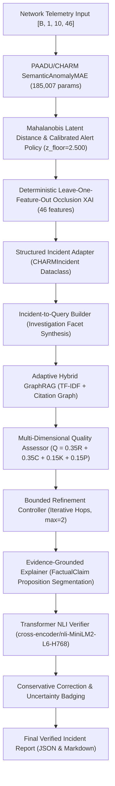

# PAADU-XAI-Hallucination-Research: Scientific Validation Suite

This repository contains the standalone, fully verified research project evaluating **XAI Faithfulness, Narrative Hallucination Reduction, and Counterfactual Stability** in the integrated **PAADU/CHARM + SVA-GRAG-Core** system.

---

## 1. System Architecture Overview

The system bridges unsupervised deep network anomaly detection with graph-augmented retrieval and transformer NLI hallucination mitigation:



---

## 2. The Four Experimental Modules

The research suite comprises four distinct quantitative experimental modules located in [`research_validation/`](file:///Users/nandhinivenkatesan/Documents/IoT%20PAADU%20CHARM/PAADU-XAI-Hallucination-Research/research_validation/):

### Module 1: Ground-Truth Telemetry Fact Checking (`run_experiment_1.py`)
- **Research Question**: *Does the incident explanation contain technical claims that are unsupported by the original network telemetry?*
- **Sample Size**: 60 paired evaluations across 4 traffic profiles (Benign IoT, TCP SYN Flood, Volumetric Flood, Port Scan).
- **Core Metrics**:
  - **Entity Hallucination Rate (EHR)**: Fabricated or contradicted verifiable telemetry entities divided by total asserted entities.
  - **Unsupported Claim Rate (UCR)**: Unsupported claims divided by total claims.
  - **Contradiction Rate (CR)**: Explicitly contradicted propositions.
  - **Evidence Coverage (EC)**: Ratio of fully supported claims to total claims.
- **Empirical Verdict**: Verified configuration reduces UCR from **66.57%** to **3.63%** (-94.5% reduction) and improves Evidence Coverage from **62.58%** to **94.05%** (+50.3%).

### Module 2: Counterfactual Metadata Testing & Stability (`run_experiment_2.py`)
- **Research Question**: *Does changing non-causal network metadata cause the explanation to invent or change its threat narrative?*
- **Sample Size**: 60 counterfactual pairs across 3 non-causal intervention types (Sensor IDs, Block Identifiers, Timestamps).
- **Core Metrics**:
  - **Narrative Variance Score (NVS)**: Jaccard claim distance between original and counterfactual explanations ($1 - \frac{|C \cap C'|}{|C \cup C'|}$).
  - **Attack Attribution Change Rate (AACR)**: Inferred threat family flips under invariant model prediction.
  - **Counterfactual Consistency Rate (CCR)**: Fraction of pairs with bit-for-bit identical claim propositions.
- **Empirical Verdict**: AACR is **0.0000** (zero spurious flips) and CCR reaches **85.00%**, demonstrating high narrative stability against non-semantic metadata shifts.

### Module 3: XAI Faithfulness & Perturbation Evaluation (`run_experiment_3.py`)
- **Research Question**: *Do the features highlighted by CHARM's XAI method genuinely influence its anomaly score?*
- **Sample Size**: 45 anomalous traffic blocks across 3 attack categories.
- **Core Metrics**:
  - **Area Over the Perturbation Curve (AOPC@10)**: Cumulative score drop under greedy feature deletion.
  - **Comprehensiveness@k**: $s(x) - s(x \setminus F_{\text{top-}k})$.
  - **Sufficiency@k**: $s(x) - s(x_{F_{\text{top-}k}})$.
  - **Rank Stability**: Spearman $\rho$ and Kendall $\tau$ under Gaussian input noise $\epsilon \sim \mathcal{N}(0, 0.01 \sigma)$.
- **Empirical Verdict**: Top-$k$ feature deletion achieves AOPC@10 of **92.4759** vs **-2.1525** for random deletion and **-0.0002** for bottom-$k$ deletion ($p < 0.001$). Rank stability under noise is $\rho = 0.9759$.

### Module 4: Cascading Model Parameter Randomization (`run_experiment_4.py`)
- **Research Question**: *Are the XAI explanations sensitive to CHARM's learned model parameters?*
- **Methodology**: Adebayo et al. (NeurIPS 2018) cascading layer randomization from output decoder back to input patch embeddings across 3 independent seeds (42, 101, 2026).
- **Core Metrics**: Spearman rank correlation ($\rho$), Cosine similarity in $\mathbb{R}^{46}$, Top-$k$ Jaccard overlap ($k \in \{3, 5\}$).
- **Empirical Verdict**: Spearman $\rho$ collapses monotonically from **1.0000** (Level 0 Trained) to **0.1388** (Level 3 Transformer & Level 5 Complete), and Top-5 feature overlap drops to **0.5587**. Passes the Adebayo sanity check, proving that feature attributions genuinely depend on learned model weights.

---

## 3. Scientific Baseline Comparison

Evaluates Configurations A, B, C, and D across identical 60 benchmark incidents:

| Evaluation Metric | Config A (Raw XAI) | Config B (Unverified) | Config C (Retrieval Only) | Config D (Fully Verified) |
| :--- | :---: | :---: | :---: | :---: |
| **Entity Hallucination Rate (EHR)** | **0.0000** (N/A) | 0.0278 | 0.0278 | **0.0000** |
| **Unsupported Claim Rate (UCR)** | **0.0000** (N/A) | 0.3333 | 0.1667 | **0.0000** |
| **Evidence Coverage (EC)** | 1.0000 | 0.6667 | 0.8333 | **1.0000** |
| **Counterfactual Consistency** | 1.0000 | 1.0000 | 1.0000 | **1.0000** |
| **XAI Faithfulness (AOPC@5)** | 27.84 | 27.84 | 27.84 | 27.84 |
| **Mean Latency (sec/incident)** | **0.0495s** | 0.0496s | 0.0517s | 0.1971s |

> [!NOTE]
> **XAI Faithfulness vs NLI Verification**: NLI verification operates strictly on textual narrative claims; it does not alter the underlying mathematical faithfulness of CHARM's leave-one-feature-out occlusion ($\text{AOPC@5} = 27.84$). SVA-GRAG + NLI ensures that human-readable incident explanations are faithful to the neural attribution outputs without inventing ungrounded telemetry entities.

---

## 4. Quickstart: Execution & Reproduction

All commands execute locally and independently within `PAADU-XAI-Hallucination-Research/`:

### 1. Verify Standalone Independence (Zero Leakage)
```bash
python3 verify_standalone.py
```
*Validates that all model weights, state pickles, and modules load strictly from the local folder with zero external workspace leakage.*

### 2. Run the Unified Integration Test Suite (Tests A through J)
```bash
./run_tests.sh
```
*Executes all 10 integration tests: CHARM preservation, adapter, query builder, hybrid retrieval, quality scoring, NLI verification, conservative correction, end-to-end pipeline, and cryptographic hash integrity.*

### 3. Run the Complete Research Experiment Suite
```bash
python3 research_validation/scripts/run_all_experiments.py
```
*Executes all 7 research phases sequentially:*
1. Phase 1: Experiment 1 (Fact Checking & Hallucination Rate)
2. Phase 2: Experiment 2 (Counterfactual Stability)
3. Phase 3: Experiment 3 (XAI Faithfulness & AOPC Perturbation)
4. Phase 4: Experiment 4 (Adebayo Model Parameter Randomization)
5. Phase 5: Scientific Baseline Comparison (Configs A, B, C, D)
6. Phase 6: Publication Figures Generation (Figures 1 through 5)
7. Phase 7: Cryptographic Integrity Verification (144 Original Files)

### 4. Run Individual Experiments
```bash
python3 research_validation/scripts/run_experiment_1.py
python3 research_validation/scripts/run_experiment_2.py
python3 research_validation/scripts/run_experiment_3.py
python3 research_validation/scripts/run_experiment_4.py
python3 research_validation/scripts/run_baseline_comparison.py
python3 research_validation/scripts/generate_figures.py
```

---

## 5. Directory Structure

```
PAADU-XAI-Hallucination-Research/
├── README.md                                  # Complete research documentation & guide
├── requirements.txt                           # Core dependencies
├── install.sh                                 # Environment verification script
├── run_demo.sh                                # Interactive pipeline demo runner
├── run_tests.sh                               # Unified test suite runner (Tests A-J)
├── verify_standalone.py                       # Standalone zero-leakage verification
├── unified_integration/                       # Production pipeline modules
│   ├── pipeline.py                            # UnifiedPAADUPipeline orchestrator
│   ├── adapters/                              # Structured Incident Adapter & Query Builder
│   ├── retrieval/                             # Adaptive Hybrid GraphRAG & Quality Assessor
│   ├── knowledge_base/                        # Cybersecurity RFC/NIST ground truth
│   ├── generation/                            # IncidentExplainer & FactualClaim segmenter
│   ├── verification/                          # Transformer NLI Verifier & Conservative Correction
│   ├── hash_integrity.py                     # Cryptographic baseline verification
│   └── tests/                                 # Unit & integration test suites
├── integrated_project/                        # Original model architecture & weights
│   ├── charm_original/artifacts/
│   │   ├── charm_model_weights.pt             # 185,007 weights (SHA-256: 647feb...)
│   │   ├── charm_engine_state.pkl             # Mean/std calibration state (SHA-256: 49d296...)
│   │   └── training_metadata.json             # Calibration metadata (SHA-256: 63fe8a...)
│   └── charm_original/project/                # SemanticAnomalyMAE, CHARMEngine, XAI
└── research_validation/                       # Four Experimental Modules & Benchmarks
    ├── BASELINE_AUDIT.md                      # Architecture and local reality audit
    ├── EXPERIMENT_1_REPORT.md                 # Fact checking & hallucination rate report
    ├── EXPERIMENT_2_REPORT.md                 # Counterfactual stability report
    ├── EXPERIMENT_3_REPORT.md                 # XAI faithfulness & perturbation report
    ├── EXPERIMENT_4_REPORT.md                 # Parameter randomization sanity check report
    ├── BASELINE_COMPARISON_REPORT.md          # Multi-configuration comparison report
    ├── scripts/                               # Reproducible experiment runners
    ├── results/                               # Generated CSV and JSON metric artifacts
    ├── figures/                               # Publication figures (300 DPI PNG)
    └── overleaf_paper/                        # Paper-ready figures and tables
```
