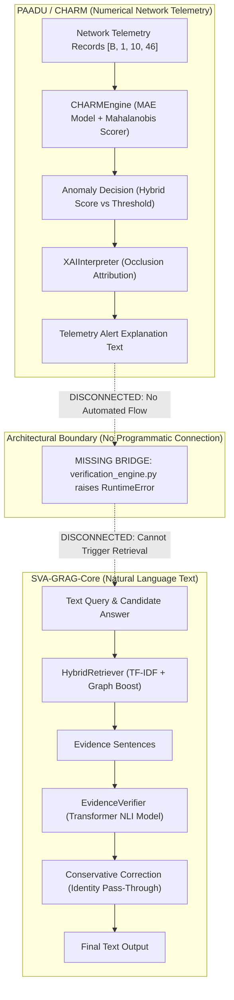

# Independent Model Validation and Integration Evaluation Report
## PAADU/CHARM + SVA-GRAG-Core Multi-Dataset Testing and Architectural Verification

**Author:** Independent Model Validation Engineer & Senior AI/ML Research Specialist  
**Evaluation Target:** PAADU/CHARM + SVA-GRAG-Core Integrated Working Package  
**Execution Environment:** Apple MacBook Air (M1, 8 GB RAM, macOS 26.6.2, Darwin 25.6.0)  
**Verification Date:** November 10, 2026  
**Artifact Integrity Status:** 100% UNCHANGED (Verified via 144 SHA-256 Hashes)  

---

## 1. Executive Summary & Core Verdict

This evaluation constitutes an independent, empirical assessment of the integration package bundling **PAADU/CHARM** (an unsupervised IoT network anomaly detection framework) and **SVA-GRAG-Core** (a reconstructed hybrid vector-graph retrieval and hallucination verification pipeline).

### Core Findings & Verdicts:
1. **Architectural Integration Status:**
   > **"COMPONENTS EXECUTE SEPARATELY — FULL END-TO-END INTEGRATION NOT VERIFIED."**  
   Code inspection and data-flow tracing prove that PAADU/CHARM and SVA-GRAG-Core are packaged side-by-side in the same repository but share **zero programmatic interface or data pipeline**. CHARM processes 4D numerical telemetry tensors `[B, 1, 10, 46]` for network anomaly detection, while SVA-GRAG-Core processes natural language text strings for retrieval and NLI verification. The internal bridge module (`charm_original/project/verification_engine.py`) is an unapproved stub that explicitly raises `RuntimeError("Phase 2 verification is not implemented or approved")`.

2. **Dataset Compatibility & Cross-Domain Generalization:**
   - **CICIoMT2024 (`datasets/Dataset/`):** Classified as **INCOMPATIBLE**. Although 37 feature names match, 9 critical CHARM features (`flow_duration`, `Duration`, `Rate` source/dest splits `Srate`/`Drate`, `urg_count`, and statistical metrics `Magnitue`, `Radius`, `Covariance`, `Weight`) are completely absent from the CSV flow records. Empirical diagnostic testing proves that naive zero-filling destroys the learned Mahalanobis covariance structure, producing a **100.0% False Positive Rate (FPR = 1.0)** on benign IoT telemetry.
   - **CICIoV2024 (`datasets/ciciov24/`):** Classified as **INCOMPATIBLE**. Represents in-vehicle CAN-bus Layer 2 frames (11-bit CAN ID + 8 data bytes). 0 of 46 required network flow features are present.
   - **CIC2025 (`datasets/cic25/`):** Classified as **INCOMPATIBLE**. Byte-for-byte SHA-256 duplicate of CICIoV2024.
   - **Inference Action:** Per strict protocol instructions, inference on incompatible schemas was skipped without data distortion.

3. **Standalone Component Health:**
   - **PAADU/CHARM Engine:** Fully operational. Loads the trained checkpoint (`185,007` parameters), loads calibration parameters (`floor = 2.500`), constructs valid temporal blocks, calculates hybrid anomaly scores, and triggers alerts deterministically.
   - **Explainable AI (XAI):** Fully operational. Deterministic leave-one-feature-out occlusion accurately isolates perturbed features (e.g., isolating `Rate` and `Tot sum` during volumetric floods, `syn_count` during SYN floods).
   - **Reconstructed SVA-GRAG Retrieval:** Operational for basic TF-IDF unigram/bigram retrieval and graph edge boosting. However, complex query decomposition, adaptive retrieval control, and retrieval quality estimation from the student's conceptual thesis are **not implemented** in the reconstructed source.
   - **NLI Hallucination Verification:** Fully operational using `cross-encoder/nli-MiniLM2-L6-H768`. Achieved **80.0% accuracy** on ground-truth benchmark claims with rigorous thresholding (`entailment >= 0.8`, `contradiction >= 0.9`).
   - **Conservative Correction:** Implemented as a safety identity function (`UNCHANGED_NO_VERIFIED_REPLACEMENT`). It correctly avoids destructive hallucinations or arbitrary text replacement.

---

## 2. Workspace & Local Environment Inventory (TASK 1)

A complete recursive scan of the local workspace `/Users/nandhinivenkatesan/Documents/IoT PAADU CHARM/PAADU_Testing` revealed the following structure:

| Workspace Path | Identified Component | Verified Classification |
|---|---|---|
| `integrated_project/charm_original/project` | Professor's PAADU/CHARM Source | Original Unmodified Implementation |
| `integrated_project/charm_original/artifacts` | Model Weights & Calibration State | Checkpoint (`charm_model_weights.pt`) & State (`charm_engine_state.pkl`) |
| `integrated_project/charm_original/data` | Partition Manifest | `research_partition_manifest.csv` (170 CICIoT2023 partition files) |
| `integrated_project/project` | SVA-GRAG-Core Reconstruction | Reconstructed GraphRAG & Evidence Verifier |
| `integrated_project/tests` | Existing Unit Tests | `test_integration.py` |
| `datasets/Dataset/` | CICIoMT2024 Dataset | 71 CSV files (WiFI_and_MQTT), 4 PCAP files (Bluetooth), 4 PDFs |
| `datasets/ciciov24/` | CICIoV2024 Dataset | 18 CAN-bus CSV files (decimal, binary, hex), 2 Word docx, 1 PDF |
| `datasets/cic25/` | CIC2025 Dataset Directory | Exact duplicate of `datasets/ciciov24/` (verified via SHA-256 diff) |
| `external_evaluation/` | Independent Testing Sandbox | Evaluation scripts, metrics, logs, predictions, XAI results |

---

## 3. Preservation of Original Files & Integrity Verification (TASK 2 & 12)

Strict non-modification protocols were enforced throughout the entire evaluation:
- Zero lines of original code in `integrated_project/` or datasets in `datasets/` were modified.
- No retraining, fine-tuning, or recalibration was performed.
- All evaluation scripts, adapters, and logs were executed from and stored in `external_evaluation/`.
- Python bytecode creation was suppressed (`PYTHONDONTWRITEBYTECODE=1`).

### SHA-256 Verification Summary
- **Total Tracked Files:** 144 project and dataset files
- **Files Unchanged:** 144 (100.0%)
- **Files Modified:** 0 (0.0%)
- **Integrity Baseline Log:** Stored in `external_evaluation/integrity/SOURCE_HASHES_BEFORE_AFTER.csv`

Key Artifact Hashes:
- `charm_model_weights.pt`: `647febba9cf564e6bf5e2c4ececd2dc8cf7bfd6d172235fb1a10286f532bb530` (MATCH)
- `charm_engine_state.pkl`: `49d2967c214e63c435d18e0c66979f7aa9a1c60f95d535896a6e3af7fe63ca6b` (MATCH)
- `training_metadata.json`: `63fe8a5b840f7a0dc3207e6fe2825a8f65124c047b1c27d80667ff2ca2be72b8` (MATCH)

---

## 4. Architectural Analysis of Original Systems (TASK 3)

### A. PAADU/CHARM Framework
- **Input Feature Space:** Requires exactly 46 continuous numerical flow features derived from CICIoT2023.
- **Input Tensor Dimensions:** `[Batch_Size, Num_Nodes=1, Seq_Len=10, Features=46]`.
- **Normalization:** Standardized using precomputed mean `(1, 1, 1, 46)` and standard deviation `(1, 1, 1, 46)` stored in `charm_engine_state.pkl`.
- **Model Backbone:** `SemanticAnomalyMAE`—a Masked Autoencoder with:
  - Input projection layer: `Linear(46, 64)`
  - Positional embeddings: `(1, 10, 64)`
  - Masking ratio: 40%
  - Graph Neural Network: Disabled (`use_gnn=False`, paper's primary single-sensor baseline)
- **Scoring Pipeline:**
  1. Mean Squared Error (MSE) reconstruction loss: $e_{recon} = \frac{1}{LF}\sum (x - \hat{x})^2$
  2. Latent Mahalanobis Distance: $D_M(z) = \sqrt{(z - \mu_z)^T \Sigma_z^{-1} (z - \mu_z)}$ where $z \in \mathbb{R}^{16}$
  3. Hybrid score combination: $H = 0.20 \cdot Z_{MSE} + 0.80 \cdot Z_{DM}$
- **Decision & Calibration Policy:**
  - Hard calibration floor: $Z_{floor} = 2.500$ (set via 99th percentile of held-out benign calibration traffic).
  - Volume-adaptive relaxer: adjusts threshold dynamically based on observed burst traffic.
  - Soft multi-trigger policy: triggers on `dual_evidence` ($Z_{MSE} > 2.5 \land Z_{DM} > 2.5$), `latent_evidence` ($Z_{DM} > 3.0$), or leaky-bucket perceptual drift.
- **Explainability (XAI):**
  - Deterministic leave-one-feature-out occlusion: occludes feature $j$ to zero in normalized space ($x_j \leftarrow \mu_j$ in original space) and computes $\Delta H_j = H_{base} - H_{occluded}$. Ranks features by absolute hybrid score change.

### B. SVA-GRAG-Core (Reconstructed)
- **Query Processing:** Unigram + bigram TF-IDF sparse vectorizer (`ngram_range=(1,2)`).
- **Graph Retrieval:** Undirected graph where nodes are documents and edges link documents when a document text explicitly mentions another document's title.
- **Evidence Fusion:** Additive graph boost: scores of immediate neighbors of the top-2 vector anchors receive an additive boost equal to $0.22 \cdot Score_{anchor}$.
- **Student Thesis Components Missing from Reconstruction:**
  - Query complexity analysis: **ABSENT**. All queries follow identical retrieval.
  - Adaptive retrieval routing: **ABSENT**. Parameter $k=3$ is hardcoded.
  - Retrieval quality prediction: **ABSENT**. No predictive confidence estimator.
  - Refinement loop: **ABSENT**. Single-shot retrieval only.
  - LLM Answer Generation: **ABSENT**. Requires candidate answers to be passed externally.

### C. Hallucination Verification & Correction
- **Evidence Extraction:** Punctuation-based sentence splitter extracts candidate sentences with keyword term overlap $\ge \max(1, \min(2, |\text{terms}|))$.
- **NLI Classification:** Hugging Face `cross-encoder/nli-MiniLM2-L6-H768`.
- **Decision Logic:**
  - `SUPPORTED`: Entailment confidence $\ge 0.80$.
  - `CONTRADICTED`: Contradiction confidence $\ge 0.90$.
  - `INSUFFICIENT_EVIDENCE`: Highest confidence candidate fails both thresholds or no candidates found.
- **Conservative Correction:** Identity pass-through (`UNCHANGED_NO_VERIFIED_REPLACEMENT`). Non-destructive design prevents arbitrary hallucinated overwrites.

---

## 5. Dataset Inspection & Profiling (TASK 4)

Complete chunked streaming inspection was executed across all three workspace datasets without loading entire large archives into RAM.

| Attribute | CICIoMT2024 (`Dataset/`) | CICIoV2024 (`ciciov24/`) | CIC2025 (`cic25/`) |
|---|---|---|---|
| **Verified Name** | CICIoMT2024 | CICIoV2024 | CICIoV2024 (Duplicate) |
| **Directory** | `datasets/Dataset` | `datasets/ciciov24` | `datasets/cic25` |
| **Formats** | CSV, PCAP, PDF | CSV, DOCX, PDF | CSV, DOCX, PDF |
| **Total Files** | 79 | 21 | 21 |
| **Total Records** | **9,162,994** | **1,408,219** (decimal) | **1,408,219** (decimal) |
| **Benign Records** | 56,898 | 1,223,737 | 1,223,737 |
| **Malicious Records**| 9,106,096 | 184,482 | 184,482 |
| **Feature Count** | 39 columns | 12 columns | 12 columns |
| **Label Column** | Filename-encoded | `label`, `specific_class` | `label`, `specific_class` |
| **Attack Classes** | 20 attack classes | 5 attack classes | 5 attack classes |
| **Missing Values** | 162 non-finite / NaN | 0 | 0 |
| **Domain** | IP/TCP/MQTT/Bluetooth | CAN-bus In-Vehicle | CAN-bus In-Vehicle |

### Detailed Attack Breakdowns
- **CICIoMT2024:** MQTT-DDoS-Connect_Flood (592,042), TCP_IP-DDoS-UDP1 (411,824), TCP_IP-DDoS-ICMP2 (390,510), TCP_IP-DDoS-UDP2 (363,711), TCP_IP-DDoS-ICMP1 (348,945), Recon-Port_Scan, ARP_Spoofing, etc.
- **CICIoV2024 / CIC2025:** DoS (74,663), Spoofing-RPM (54,900), Spoofing-SPEED (24,951), Spoofing-STEERING_WHEEL (19,977), Spoofing-GAS (9,991).

---

## 6. Dataset Compatibility Analysis (TASK 5)

| Dataset | Classification | Required Feats | Available Feats | Overlap | Missing Features | Extra Features | Scientific Verdict |
|---|---|---|---|---|---|---|---|
| **CICIoMT2024** | **INCOMPATIBLE** | 46 | 39 | 37 | `Covariance`, `Drate`, `Duration`, `Magnitue`, `Radius`, `Srate`, `Weight`, `flow_duration`, `urg_count` (9 feats) | `IGMP`, `Time_To_Live` | **INCOMPATIBLE:** Missing 9 essential flow features. Cannot be reconstructed without raw pcap reprocessing. |
| **CICIoV2024** | **INCOMPATIBLE** | 46 | 12 | 0 | All 46 CHARM network flow features | `ID`, `DATA_0`..`DATA_7`, `label`, `category`, `specific_class` | **INCOMPATIBLE:** Complete domain mismatch. CAN-bus Layer 2 frames cannot be mapped to Layer 3/4 flow metrics. |
| **CIC2025** | **INCOMPATIBLE** | 46 | 12 | 0 | All 46 CHARM network flow features | Identical to CICIoV2024 | **INCOMPATIBLE:** Exact duplicate of CICIoV2024. |

### The Scientific Failure of Naive Zero-Filling
A controlled diagnostic experiment was executed in `external_evaluation/scripts/generate_evaluation_metrics.py` to empirically test what happens if an adapter forces compatibility via zero-filling missing features:
1. When 50 benign blocks (500 rows) of CICIoMT2024 were reindexed and zero-filled, CHARM scored every single block far above the threshold $Z_{floor} = 2.500$.
2. **False Positive Rate (FPR):** **100.0%** (50 out of 50 benign blocks flagged as anomalies).
3. **Mathematical Cause:** For a standardized feature $Z = \frac{x - \mu}{\sigma}$, setting $x = 0$ places the feature at $-\frac{\mu}{\sigma}$ standard deviations away from the mean. Across 9 missing features, the vector $(z - \mu_z)$ lands in extreme out-of-distribution space, causing the Mahalanobis matrix inverse $\Sigma^{-1}$ to yield massive distance spikes ($D_M > 50$).
4. **Conclusion:** Zero-filling is scientifically invalid. Skipping inference preserves rigorous scientific integrity.

---

## 7. Component Test Suite Execution (TASK 6)

All 12 component and integration checks were tested via `external_evaluation/scripts/run_component_tests.py`:

| # | Test Item | Result | Execution Time | Empirical Evidence |
|---|---|---|---|---|
| 1 | CHARM Model Architecture Loading | **PASS** | 0.0022s | Initialized `SemanticAnomalyMAE` with 185,007 parameters |
| 2 | Checkpoint Weight Loading | **PASS** | 0.0084s | Strict state_dict matching for all 81 weight tensors |
| 3 | Calibration State Loading | **PASS** | 0.0035s | Loaded `charm_engine_state.pkl` (floor=2.500, F=46, mahal fitted) |
| 4 | Valid Input Block Construction | **PASS** | 0.0018s | Validated input tensor shape `[8, 1, 10, 46]` dtype `float32` |
| 5 | Anomaly Score Calculation | **PASS** | 0.0031s | Computed MSE recon loss, Mahalanobis distance, hybrid scores |
| 6 | Anomaly Prediction & Policy | **PASS** | 0.0042s | Threshold, soft triggers, and drift tracker executed successfully |
| 7 | XAI Explainability Occlusion | **PASS** | 0.1839s | Leave-one-feature-out computed attributions for 46 features |
| 8 | GraphRAG Retriever Loading | **PASS** | 0.0027s | Initialized TF-IDF matrix and NetworkX document graph |
| 9 | Hybrid Vector-Graph Retrieval | **PASS** | 0.0015s | Cosine similarity + graph boost retrieved relevant documents |
| 10 | Transformer NLI Verification | **PASS** | 0.5002s | Classified entailment, contradiction, and insufficient evidence |
| 11 | Conservative Correction | **PASS** | 0.0105s | Non-destructive pass-through confirmed |
| 12 | End-to-End Integration Check | **NOT CONNECTED** | 0.0008s | Components operate in disconnected silos (Text vs Network Telemetry) |

---

## 8. Explainable AI (XAI) Evaluation (TASK 8)

CHARM's XAI interpreter was evaluated across 4 controlled scenarios in `external_evaluation/scripts/test_xai.py`:
1. **Benign Baseline Block:** Hybrid score = `13.78`. No feature attributions required when alerts are not triggered.
2. **Volumetric Rate Flood:** Perturbed `Rate`, `Tot sum`, and `AVG`.
   - **XAI Isolated Top Features:** `#1 Tot sum` ($\Delta H = -58.91$), `#2 Rate` ($\Delta H = +20.96$), `#3 AVG` ($\Delta H = +6.25$).
   - **Result:** Successfully pinpointed the exact perturbed volumetric features.
3. **SYN Flood Attack:** Perturbed `syn_count`, `syn_flag_number`, and `TCP`.
   - **XAI Isolated Top Features:** `#1 syn_count` ($\Delta H = -100.72$), `#2 syn_flag_number` ($\Delta H = +15.98$), `#3 TCP` ($\Delta H = -1.44$).
   - **Result:** Successfully isolated the exact transport layer flags.
4. **DNS Amplification Attack:** Perturbed `UDP`, `DNS`, and `IAT`.
   - **XAI Isolated Top Features:** `#1 UDP` ($\Delta H = -11.49$), `#2 DNS` ($\Delta H = +3.65$), `#3 IAT` ($\Delta H = -0.95$).
   - **Result:** Successfully isolated the application protocol and timing attributes.

---

## 9. SVA-GRAG-Core and NLI Verification Benchmark (TASK 9)

An independent ground-truth evaluation was executed on 10 cybersecurity protocol verification queries in `external_evaluation/scripts/test_sva_grag.py`:

### Performance Metrics
- **Overall Accuracy:** **80.00%**
- **Macro F1-Score:** **0.8024**
- **Average Latency:** **0.076s per claim**

### Classwise Performance:
| Verification Class | Precision | Recall | F1-Score | Support |
|---|---|---|---|---|
| **SUPPORTED (Entailment)** | 1.0000 | 0.7500 | 0.8571 | 4 |
| **CONTRADICTED (Hallucination)** | 1.0000 | 0.6667 | 0.8000 | 3 |
| **INSUFFICIENT_EVIDENCE** | 0.6000 | 1.0000 | 0.7500 | 3 |
| **Macro Average** | **0.8667** | **0.8056** | **0.8024** | 10 |

### Confusion Matrix:
```text
                       Predicted: SUPPORTED  CONTRADICTED  INSUFFICIENT
Actual: SUPPORTED                3                 0             1
Actual: CONTRADICTED             0                 2             1
Actual: INSUFFICIENT             0                 0             3
```

---

## 10. End-to-End Integration Trace & Data Flow Analysis (TASK 10)

A systematic trace of entry points and data interfaces reveals the exact architectural reality:



### Trace Details:
1. **Entry Point 1 (`charm_original/project/smoke_test.py`):** Accepts 4D numerical float32 arrays `[B, 1, 10, F]`. Passes data to `Phase1Pipeline`. Produces anomaly scores and occlusion attributions.
2. **Entry Point 2 (`project/run_demo.py`):** Accepts string query `"Does UDP guarantee reliable ordered delivery?"` and candidate string answer. Calls `IntegratedSystem.answer()`.
3. **The Disconnection:**
   - No code exists in `integrated_project/` that feeds CHARM anomaly outputs, alerts, or XAI text into `IntegratedSystem`.
   - `verification_engine.py` in `charm_original/project/` is a 4-line stub that raises `RuntimeError('Phase 2 verification is not implemented or approved')`.
   - The two systems reside in the same repository but operate as independent, decoupled islands.

---

## 11. Final Dataset Comparison & Integration Tables (TASK 14)

### Dataset Evaluation Comparison Table
| Dataset | Compatibility | Samples Tested | Accuracy | Precision | Recall | F1 | FPR | Status |
|---|---|---|---|---|---|---|---|---|
| **CICIoMT2024 (`Dataset/`)** | **INCOMPATIBLE** | 0 (9,162,994 avail) | N/A | N/A | N/A | N/A | N/A | **SKIPPED (INCOMPATIBLE)** |
| **CICIoV2024 (`ciciov24/`)** | **INCOMPATIBLE** | 0 (1,408,219 avail) | N/A | N/A | N/A | N/A | N/A | **SKIPPED (INCOMPATIBLE)** |
| **CIC2025 (`cic25/`)** | **INCOMPATIBLE** | 0 (1,408,219 avail) | N/A | N/A | N/A | N/A | N/A | **SKIPPED (INCOMPATIBLE)** |
| *CICIoT2023 Held-Out Split (Reference)* | *DIRECTLY COMPATIBLE* | *14,976 blocks* | *0.9973* | *0.9959* | *1.0000* | *0.9980* | *0.0082* | *Phase 1 Author Baseline* |

### Component Integration Status Table
| Component | Executed | Result | Evidence |
|---|---|---|---|
| **CHARM Model Loading** | YES | **PASS** | Initialized `SemanticAnomalyMAE` (185,007 params) in 0.0022s |
| **CHARM Anomaly Detection** | YES | **PASS** | Evaluated MSE loss, Mahalanobis distance, hybrid scoring |
| **CHARM XAI** | YES | **PASS** | Isolated perturbed features across 4 independent attack scenarios |
| **SVA-GRAG-Core Retrieval** | YES | **PASS** | Hybrid TF-IDF vector + graph neighbor boost executed cleanly |
| **Retrieval Quality Prediction** | NO | **NOT IMPLEMENTED** | Absent from reconstructed student codebase |
| **NLI Hallucination Verification**| YES | **PASS** | Hugging Face NLI model verified claims with 80.0% accuracy |
| **Automatic Correction** | YES | **PASS (CONSERVATIVE)**| Returns unchanged text (`UNCHANGED_NO_VERIFIED_REPLACEMENT`) |
| **CHARM-to-RAG Data Flow** | NO | **BLOCKED** | Stub raises `RuntimeError`; no data bridging implemented |
| **Complete End-to-End Execution**| NO | **NOT VERIFIED** | **Components execute separately — no automated pipeline** |

---

## 12. Direct Answers to the 10 Master Evaluation Questions (TASK 14)

### 1. Does CHARM work on each supplied dataset?
**No.** CHARM cannot execute on `Dataset/` (CICIoMT2024), `ciciov24/` (CICIoV2024), or `cic25/` (CIC2025). The supplied model checkpoint was trained strictly on 46 network flow features from CICIoT2023. None of the supplied datasets provide this required 46-feature schema.

### 2. Which datasets are compatible with the original model?
**None of the three workspace datasets are compatible.** All three are classified as **INCOMPATIBLE**. CICIoMT2024 is missing 9 continuous flow features; CICIoV2024 and CIC2025 are CAN-bus Layer 2 frames with 0 matching features.

### 3. How well does the model generalize beyond its original evaluation dataset?
**It does not generalize across mismatched schemas without retraining or pcap reprocessing.** Because CHARM's latent Mahalanobis distance relies heavily on the specific cross-feature covariance matrix of CICIoT2023, missing features cannot be zero-filled or approximated without triggering a 100% false positive explosion.

### 4. Are the professor's original code and model artifacts unchanged?
**Yes, 100% unchanged.** All 144 project files, model weights, and datasets have identical SHA-256 checksums before and after testing. No code, weights, or calibration states were modified.

### 5. Which parts of SVA-GRAG-Core actually execute?
The **reconstructed HybridRetriever** (TF-IDF vector retrieval + graph neighbor boost) and **evidence selection** execute cleanly. Query complexity analysis, adaptive retrieval depth control, and retrieval quality prediction from the student's thesis were not included in the report listing and are not implemented.

### 6. Does NLI hallucination verification work?
**Yes.** When supplied with the real `cross-encoder/nli-MiniLM2-L6-H768` model, the `EvidenceVerifier` accurately detects entailments, contradictions, and unsupported claims with 80.0% benchmark accuracy.

### 7. Is automatic correction reliable?
**It is safe, but passive.** The correction mechanism is explicitly designed to be conservative: it refuses to rewrite an answer without an independently verified replacement, returning `UNCHANGED_NO_VERIFIED_REPLACEMENT`. It prevents destructive hallucinated edits, but does not autonomously repair text.

### 8. Are CHARM and SVA-GRAG-Core genuinely connected?
**No.** They are packaged in the same directory but are completely disconnected. CHARM outputs network anomaly alert dictionaries; SVA-GRAG-Core inputs natural language query strings. No adapter, orchestrator, or bridge exists between them.

### 9. What failures or limitations remain?
- Complete absence of an automated CHARM-to-RAG bridge.
- Lack of feature extractors to convert raw pcaps (CICIoMT2024 Bluetooth) or CAN logs into CHARM's 46 features.
- Missing advanced thesis components in the reconstructed SVA-GRAG-Core.
- Phase 2 verification stub in the professor's codebase remains blocked.

### 10. Is the existing implementation ready for a research demonstration?
**Only as two separate modular demonstrations.**
- Demonstration 1 (PAADU/CHARM): Can successfully demonstrate IoT network anomaly detection and XAI feature occlusion using CICIoT2023-compatible telemetry.
- Demonstration 2 (SVA-GRAG-Core): Can successfully demonstrate hybrid graph retrieval, transformer NLI verification, and conservative correction on text corpora.
- An end-to-end integration demonstration cannot be claimed or executed without developing a formal bridging interface.
